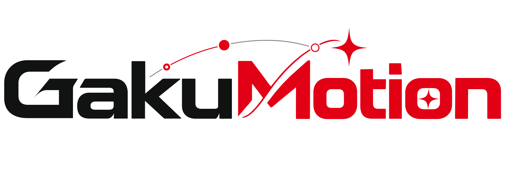

<picture>
  <source media="(prefers-color-scheme: dark)" srcset="assets/branding/gakumotion-wordmark-dark.svg">
  
</picture>

在《学园偶像大师》（PC DMM 版）中回放 MMD 动作、表情、运镜与音频的模组插件。

[安装指南](docs/INSTALLATION.md) · [使用指南](docs/USAGE.md) · [常见问题排查](docs/TROUBLESHOOTING.md) · [源码构建](BUILD_NOTES.md) · [全部文档索引](docs/README.md)

## 这是什么

GakuMotion 是运行在 [GakuLoader](https://github.com/crested-ezios/GakuLoader) 插件宿主之上的动作播放模组。它允许玩家在《学园偶像大师》的偶像摄影棚及更衣室中，让角色回放 MMD 动作（VMD 格式）、面部表情、眼动与摄像机运镜，并同步播放 16-bit PCM WAV 音频。模组不修改游戏的原版可执行程序或 AssetBundle 资源文件。VMD 文件的解析由配套的原生 NativeAOT 导入器完成，日常使用时无需安装 Python 或 .NET 运行环境。

## 准备工作与依赖

### 前置要求
- 操作系统：Windows 10 / 11 64 位（x64）
- 宿主程序：[GakuLoader](https://github.com/crested-ezios/GakuLoader)（游戏根目录下的 `version.dll`）
- 核心文件：配套版本的 `GakuMotion.dll` 与 `GakuMotion.VmdImporter.Native.dll`

### 文件放置路径

退出游戏后，将相关文件放置在游戏根目录下对应的文件夹中。未执行数据布局迁移时，目录如下：

```text
<游戏根目录>/
├── gakumas.exe
├── version.dll                              # GakuLoader 宿主
└── gakumas-local/
    ├── gakuloader.log                       # 运行日志
    ├── GakuMotion/                          # 配置与导入日志
    ├── motions/                             # 曲库，每支曲目使用独立子目录
    │   └── MyDance/
    │       ├── motion.gkclip                 # 导入后的身体动作
    │       ├── camera.gkcamera               # 运镜，可选
    │       └── song.wav                      # PCM WAV 音频，可选
    └── plugins/                             # 插件目录
        ├── GakuMotion.dll                   # 动作播放插件核心
        └── GakuMotion.VmdImporter.Native.dll # VMD 原生导入器
```

可以直接解压候选发布包中的完整安装包，也可以按 [构建指南](BUILD_NOTES.md) 自行编译。升级时覆盖这两个 DLL 即可，不会影响已有曲库素材或个人配置。若需要整理早期版本的文件分布，可参考 [数据布局与迁移指南](docs/MIGRATION_LAYOUT.md)。

完成迁移后，配置位于 `gakumas-local/Configs/gakumotion/`，曲库位于 `gakumas-local/UserData/gakumotion/motions/`，播放列表和活动回执位于 `gakumas-local/PluginData/gakumotion/`，导入日志位于 `gakumas-local/Logs/gakumotion/`。有效活动回执才会切换布局；仅覆盖 DLL 不会搬动用户文件。导入 VMD 请使用面板，备份时保留完整曲目目录及 `.gakumotion-trash` 恢复区。

## 使用方法与快捷键

启动游戏并进入“偶像摄影”页面，通过以下快捷键与面板进行操作：

| 快捷键 | 功能 | 说明 |
| --- | --- | --- |
| **Ctrl+M** | 唤出或唤回控制面板 | 仅在支持的偶像摄影或更衣室页面中响应 |
| **F9** | 播放 / 暂停 | 切换当前动作的播放与暂停状态 |
| **F10** | 停止播放并释放接管 | 停止动作，角色恢复游戏原生姿态 |

### 常用操作流程
1. **呼出面板**：进入偶像摄影棚后，按 **Ctrl+M** 唤出 GakuMotion 控制面板。
2. **导入资源**：切换到“曲库”页签，可以直接将 VMD 动作文件、表情文件、镜头文件以及 WAV 音频拖入窗口，也可点击“导入”按钮选取文件。
3. **播放与预览**：在列表中选中曲目后，点击“加载预览”可查看动作第一帧；点击“播放选中”开始正式表演。
4. **调整控制**：
   - 播放进度：支持时间轴拖动、帧定位与逐帧查看。
   - 速度与时差：支持全局播放倍速调节，以及单独微调音频和动作的秒级时间偏移。
   - 运镜模式：镜头页与播放器统一提供“游戏 / VMD / 跟随 / 注视”。选择“游戏”释放 Motion 镜头接管并保留参数，恢复游戏手动取景；选择 VMD 播放曲目运镜，无可用轨道时保持机位。旧固定模式配置会在载入时迁移为 VMD。

详细的功能说明与进阶设置请查阅 [使用指南](docs/USAGE.md)。

## 常见问题与排查

1. **按 Ctrl+M 无法打开面板**：
   - GakuMotion 仅在偶像摄影及指定更衣室页面开放。游戏主界面、Live 演出、养成培育和未适配页面默认不开放接管，按键不会响应。
   - 检查 `gakumas-local/gakuloader.log`，确认 `GakuMotion.dll` 是否已成功被加载。
2. **接管期间官方拍照按钮无法点击**：
   - 在 GakuMotion 接管角色骨骼期间，为了避免相机和姿态产生冲突，模组会自动屏蔽游戏官方的手动拍照入口。停止播放（按 **F10**）或收起接管后即可恢复。详情见 [页面准入与拍照边界](docs/USAGE.md#打开面板)。
3. **VR 模式下镜头控制不生效**：
   - 与 [GakuVRify](https://github.com/crested-ezios/gakumas-VRify) 同时使用时，Motion 运镜仍有已知兼容问题，不能假定镜头会自动让位。遇到镜头冲突时，先选择“游戏”释放 Motion 镜头接管，并在反馈中注明 VR 状态。镜头选择修订与验证范围见 [恢复候选记录](docs/CAMERA_MODE_RECOVERY_20261104.md)，VR 限制见 [兼容性说明](docs/USAGE.md#已知兼容性)。
4. **播放倍速不为 1.0 时没有声音**：
   - 当前音频后端不支持拉伸。音乐的有效速度是“全局播放倍速 × 音乐文件速度”，乘积不为 1.0 时静音，恢复为 1.0 后从当前位置起播。例如，全局 0.5 倍、音乐文件 2 倍时仍可有声播放；只把全局倍速调回 1.0，不一定能恢复音乐。详见 [播放时序](docs/PLAYBACK_TIMING.md)。
5. **更多排错指南**：
   - 若遇到动作导入报错或模型变形，请参考 [常见问题与排查](docs/TROUBLESHOOTING.md)。

## 源码构建

源码构建需要 Windows x64 系统，并安装 Visual Studio 2022（或更高版本，包含 MSVC C++20 工具集）以及 .NET 8 SDK。

建议使用 PowerShell 7，在 `GakuMotion` 根目录下运行构建脚本：

```powershell
# 完整编译 C++ 插件与 NativeAOT 导入器
pwsh -NoProfile -File build.ps1 -Target All
```

编译输出目录：
- `build/native/GakuMotion.dll`
- `build/nativeaot/GakuMotion.VmdImporter.Native.dll`

编译完成后，将生成的两个 DLL 复制到游戏的 `gakumas-local/plugins/` 目录中即可。更多编译选项（如仅构建 Native 或仅构建 NativeAOT）请参阅 [构建指南](BUILD_NOTES.md)。

### 相关项目与依赖
- [GakuLoader](https://github.com/crested-ezios/GakuLoader)：提供插件宿主、按键分发与控制窗口支持。
- [KineTexture](https://github.com/crested-ezios/KineTexture)：提供底层正向运动学、数学计算与动作采样能力。
- [GakuBurstBridge](https://github.com/crested-ezios/GakuBurstBridge)：可选的原生物理伴生库，用于让官方 Burst 物理读取动作输入。
- 架构分工与数据读写契约详见 [架构设计](docs/ARCHITECTURE.md) 与 [动作文件格式](docs/formats/ACTION_FORMATS.md)。
- 模组源码遵循 [MIT 许可证](LICENSE)，第三方组件遵循各自许可证，详见 [第三方通知](THIRD_PARTY_NOTICES.md)。
