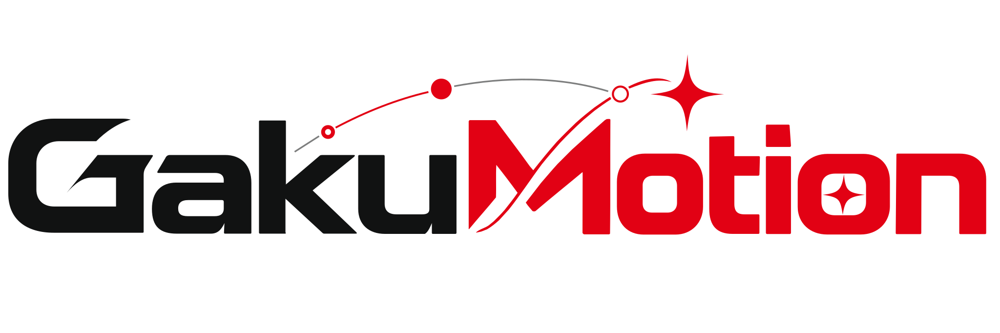

<picture>
  <source media="(prefers-color-scheme: dark)" srcset="assets/branding/gakumotion-wordmark-dark.svg">
  
</picture>

A Native Performance Extension for Gakumas

GakuMotion 是运行在 GakuLoader 之上的《学园偶像大师》原生演出扩展，使用游戏内的角色、服装和渲染环境播放外部 MMD 动作、表情、镜头与音乐。

本仓库由[野生的空白（54yq）](https://github.com/54yq)维护，基于 [crested-ezios/GakuMotion](https://github.com/crested-ezios/GakuMotion) 扩展多人同步演出、Live 舞台接管、角色站位和动作兼容性。

[上游安装指南](https://github.com/crested-ezios/GakuMotion/blob/main/docs/INSTALLATION.md) · [上游使用指南](https://github.com/crested-ezios/GakuMotion/blob/main/docs/USAGE.md) · [上游常见问题](https://github.com/crested-ezios/GakuMotion/blob/main/docs/TROUBLESHOOTING.md)

> 当前仍为开发预览版本。Live 接管、原生物理及标有“实验”的功能，需要按游戏版本、角色、服装和场景分别验证。

## 基础功能

以下能力沿用上游，基础动作功能支持摄影及指定更衣室场景；安装和通用操作请参阅上方的上游文档。

| 功能 | 说明 |
| --- | --- |
| 动作回放 | 导入 MMD/VMD 身体动作，重定向到游戏原生角色并播放。 |
| 面部表现 | 播放表情、眼动及相关面部轨道，效果取决于素材与转换支持。 |
| 镜头控制 | 支持 VMD 运镜、角色跟随、固定机位注视，也可交还游戏手动控制。 |
| 音频同步 | 同步播放 16-bit PCM WAV，分别调整动作、表情、镜头和音乐的速度及时间偏移。 |
| 曲库与播放 | 管理曲目、首帧预览、播放与暂停、循环、进度跳转、逐帧查看和全局倍速。 |
| 舞台与物理 | 调整支持场景的背景与舞台表现，提供内建次级物理和可选的 GakuBurstBridge 原生物理后端。 |

### 已合入上游的改进

以下改进由野生的空白提交 PR，已合入上游 `dev` 分支：

| 改进 | 说明 | PR |
| --- | --- | --- |
| 表情幅度 | 分别调整整体、眉毛、眼部和嘴部倍率（0.00–2.00），支持重置与保存，不改变眼骨视线或 LookAt。 | [#2](https://github.com/crested-ezios/GakuMotion/pull/2) |
| 独立音乐音量 | 调整 GakuMotion 音乐音量（0–100%）并自动保存，不改变游戏原声；旧音频后端不支持时保留原音量并提示。 | [#2](https://github.com/crested-ezios/GakuMotion/pull/2) |
| VMD 运镜范围 | 将轨迹缩放至 0.30–1.00 倍，同步处理焦点距离与正交视野，支持保存；不会自动检测碰撞。 | [#4](https://github.com/crested-ezios/GakuMotion/pull/4) |
| 辅助骨旋转修正 | 统一等价四元数的符号，避免同一旋转因符号不同而产生不同的辅助骨输出，不改写动作或主骨骼旋转。 | [#4](https://github.com/crested-ezios/GakuMotion/pull/4) |

合入 `dev` 不代表上游 `main` 或正式发布包已包含。音乐仍沿用上游限制：全局倍速与音乐文件速度的乘积不为 1.0 时静音。

## 分支扩展

### 多人同步演出与站位

动态槽位和多人原生物理对应上游 [PR #8](https://github.com/crested-ezios/GakuMotion/pull/8)，已提交、尚未合并。

- **动态角色槽位**：从早期三人同步扩展为按需添加，为场景中已检测到的角色分别绑定动作。未绑定槽位跳过，音乐、镜头、播放状态与进度统一以主角色为准。
- **独立动作与校正**：附加角色分别使用自己的动作、延迟和骨骼覆盖，表情幅度沿用面板设置。
- **位置与朝向**：分别调整主角色和附加角色的世界坐标偏移与朝向，转向同时旋转姿态和动作位移轨迹。同一场景内切换动作或重新绑定时保留站位，主角色站位可保存为启动默认值。
- **原曲队形对齐**：从各曲目原始 VMD 的第 0 帧恢复横向相对站位，按主角色朝向对齐，保留主角色位置和附加角色的垂直偏移。需要 gkclip 与校验匹配的原始 VMD，数据不足时不修改队形。
- **多人原生物理**：配合支持 V3 的 GakuBurstBridge，为各绑定角色管理独立上下文并显示实际后端；原生输入不可用时，对应角色回退内建物理。[配套源码与兼容说明](tools/GakuBurstBridge/README.md)随仓库提供。
- **角色显隐**：可分别隐藏主角色及已绑定角色的模型并恢复原渲染状态；Live 接管期间还可分别隐藏麦克风，具体支持取决于游戏接口与资源。

槽位用于绑定已有角色，人物加载由下文的 GakuActors 提供；实际人数受场景、资源与性能限制。修改绑定需先停止播放，切换场景或角色名单变化后可能需要重新绑定。多人站位预设界面暂时隐藏，已有文件保留。

### Live 观看与舞台接管（实验）

本分支在上游主线默认不开放的 Live 观看场景中增加独立入口。接管默认关闭，需确认场景、角色和拍照保护就绪后手动启用。

| 功能 | 行为与限制 |
| --- | --- |
| 原生 Live 控制 | 查看进度，暂停、继续及拖动跳转；动作接管期间禁用原生进度操作。 |
| MMD 动作接管 | 暂停原舞台，使用已识别角色播放外部动作或多人演出。退出时先恢复角色，再按接管前状态恢复 Live。 |
| 结束前循环 | 默认提前 1 秒跳回开头，可调 0.5–3 秒；暂停、接管、拍照和手动跳转期间不触发，失败或未确认回跳时关闭。音乐和特效不保证无缝衔接。 |
| 角色图独立推进 | 满足角色归属与原生物理条件时，让角色动画图在舞台暂停期间继续推进；结束后恢复时间模式、播放状态和暂停节点，不提供完整物理快照恢复。 |
| 帧数与卡顿监测 | 内置 Unity 更新频率、帧间隔、近期基准和卡顿计数，并记录排查线索；指标不等于显示器输出帧率，也不能单独证明卡顿原因。 |

游戏主页、养成和未适配页面仍不开放接管。不同 Live、多人组合、长时间运行及退出后的恢复效果需要分别验证；曾导致黑屏的结束回调重播路径保持禁用，当前循环使用结束前跳转。

机制和验证边界见 [Live 接管与角色图](docs/LIVE_ACTOR_CLOCK_MVP.md)、[Live 循环说明](docs/LIVE_STAGE_CLOCK_SPLIT.md)。帧数监测已内置，使用本版无需另装旧版 `GakuFrameMonitor.dll`。

### 镜头与音效

- **镜头随主角色朝向**：插件镜头的位置和方向随角色站位朝向旋转，可保存设置；不改变游戏手动镜头。
- **关闭 Live 景深（测试）**：接管期间可关闭景深，取消或退出后恢复原处理；接口启用与实际画面效果仍需分别确认。
- **屏蔽游戏音效**：独立关闭游戏 Se 音效（包含界面音效），不影响动作歌曲。开关默认关闭，在取消、离开支持场景或进入受保护拍照流程后恢复先前状态。该功能引入自 huvz04 的 [PR #13](https://github.com/crested-ezios/GakuMotion/pull/13)，当前为上游待合并草稿，本分支已整合。

### 动作导入与校正

- **源帧率与采样率分开设置**：支持自动、30 或 60 fps 源帧率，独立选择输出采样率，并可重新烘焙已有曲目。自动判断参考身体骨骼与音频，表情末帧明显较晚时提示并保留关键帧；仍可能需要手动校正。对应上游 [PR #9](https://github.com/crested-ezios/GakuMotion/pull/9)，尚未合并。
- **烘焙腿部动作兼容**：识别特征明确的 `D` 腿骨，以及普通腿骨逐帧烘焙配合空 IK 的 VMD，保留腿部姿态；显式 IK 开关、运动 IK 和无法明确识别的素材沿用原处理。对应上游 [PR #10](https://github.com/crested-ezios/GakuMotion/pull/10)，尚未合并；已有曲目需重新导入才能应用修正。
- **局部骨骼覆盖修正**：修复 gkclip 局部骨骼微调的参考帧计算。
- **按角色校正前臂（实验）**：分别调整扭转分担、轴向角度和锁定状态，未绑定角色也可预设，适用于 gkclip。默认轴向 +45°、分担 0；主角色锁定可保存，其他角色设置在当前场景保留。
- **辅助骨对照（实验）**：提供拟合、锁定初始姿态、归零、录制回放和旧版解算模式，可用 F8 切换，便于比较手臂变形。
- **载入前初始化骨骼（实验）**：在下次载入动作时重置各角色动画器，用于对照，可能改变站位和物理状态。

重新烘焙会更改已导入曲目，建议先备份；实验校正的效果随角色与动作变化，不会自动解决穿模。

### 与 GakuActors 配合

[GakuActors](https://github.com/54yq/GakuActors) 负责人物资源加载、头身组合及场景资源管理；GakuMotion 负责为人物绑定动作和接管演出。

- **人物识别与命名**：识别受支持的新增人物，修正部分角色显示名称，并展示可确认的自定义预设名。名称与预设显示对应上游 [PR #11](https://github.com/crested-ezios/GakuMotion/pull/11)，尚未合并。
- **资源显隐交接**：配套版本可在 Motion 恢复并释放资源后接手显隐控制，减少两个插件同时修改资源的冲突。
- **自由视角交接**：在 GakuActors 开启自由视角时释放 Motion 镜头，关闭后交还；自由视角入口与实现由 GakuActors 提供。

### 诊断与构建

提供原生物理与内建回退状态、匹配与写入记录、Live 状态、Swing 报告、手腕姿态及可选的连续手臂日志，并保留“角色图运行 3 秒”等测试入口。连续日志可能影响性能，计数与报告不能单独证明画面或物理效果正确。

本分支还修复了便携式 Runtime 构建在含空格路径下的问题，构建方式见 [BUILD_NOTES.md](BUILD_NOTES.md)。

## 功能演示

以下视频由野生的空白发布，均包含部分基础修正，表中列出主要展示的功能：

| 视频 | 主要展示 |
| --- | --- |
| [多人同步演出](https://www.bilibili.com/video/BV1otWa62EgK) | 多名角色分别绑定动作并同步演出。 |
| [导入未实装人物并接管舞台](https://www.bilibili.com/video/BV1G6s76KE3C/) | 使用 GakuActors 导入人物，再由 GakuMotion 接管舞台。 |
| [舞台接管与超出三人的多人演出](https://www.bilibili.com/video/BV14Ds76bE4e) | 接管舞台并导入多名人物，展示超出原三人上限的演出。 |

## 上游 PR 说明

上述 PR 状态核对于 **2026-11-17**。功能介绍已附上对应链接；分支实现与提交上游的移植版本可能存在差别，以各 PR 范围为准。

早期综合提交 [#6](https://github.com/crested-ezios/GakuMotion/pull/6) 已关闭，未整体合并，维护者曾讨论按模块择取；其中拆出的腿骨修复 [#7](https://github.com/crested-ezios/GakuMotion/pull/7) 也已关闭、未合并，后续以 #10 重新提交。

## 文档与反馈

安装、快捷键、资源准备及通用操作参阅上游文档。分支扩展的操作补充见[本分支使用说明](docs/USAGE.md)，源码构建见[本分支构建说明](BUILD_NOTES.md)，多人原生物理见 [Bridge 兼容说明](tools/GakuBurstBridge/docs/COMPATIBILITY.md)。

分支问题请提交到[本仓库 Issues](https://github.com/54yq/GakuMotion/issues)，提供插件、加载器和游戏版本、场景、角色与服装、复现步骤及相关日志。通用限制见[上游已知问题](https://github.com/crested-ezios/GakuMotion/blob/main/docs/KNOWN_ISSUES.md)。

## 相关项目

### 依赖项目

- [GakuLoader](https://github.com/Gaku-Mod-Tools/GakuLoader)：提供插件宿主、按键分发与控制窗口支持。
- [GakuActors](https://github.com/54yq/GakuActors)：可选的人物与场景资源管理插件，用于导入额外人物、管理头身组合及场景资源。
- [KineTexture](https://github.com/crested-ezios/KineTexture)：提供底层正向运动学、数学计算与动作采样能力。
- [GakuBurstBridge](https://github.com/crested-ezios/GakuBurstBridge)：可选的原生物理伴生库，用于让官方 Burst 物理读取动作输入。
- 模组源码遵循 [MIT 许可证](LICENSE)，第三方组件遵循各自许可证，详见 [第三方通知](THIRD_PARTY_NOTICES.md)。
### 参考项目与致谢

GakuMotion 的开发过程中参考了 MMD 动作生态、游戏 Mod 工具及相关研究成果。感谢以下为动作语义验证、兼容性研究和技术设计提供的帮助。
 - [Chinosk - Gakumas Localify](https://git.chinosk6.cn/chinosk/gkms-localify-dmm) — 原生插件兼容生态。
 - [KagaminTheMirror - Gakumas VRify](https://github.com/KagaminTheMirror/gakumas-VRify) — VR 兼容生态。
 - [三目YYB - YYB Hatsune Miku_Default](https://www.bilibili.com/video/BV1Bg411D7Me/) — GakuMotion VMD Source Evaluator 研究中的重要 MMD/PMX 参考模型。
 - [樋口優 - MikuMikuDance](https://www.nicovideo.jp/watch/sm2420025) — VMD 的原始执行环境。
 - [Mogg - MikuMikuMoving](https://sites.google.com/site/mikumikumovingeng/) — 另一个独立的 MMD 动作执行环境，作为动作表现验证。
 - [powroupi / 后续维护者 - blender_mmd_tools](https://github.com/powroupi/blender_mmd_tools) — MMD 数据与行为研究参考。
 - [Countd360 - MMD Director](https://www.patreon.com/posts/mmd-director-pv-55604378) — HS2/AI/KK/KKS CharaStudio的 VMD 播放与编排工具先例。
 - [ifui小灰灰 / ArinLee](https://arin3000.github.io/) — 学马仕动画与原生表现相关研究。
 - [nijinekoyo - Gakuen-idolmaster-ab-decrypt](https://github.com/nijinekoyo/Gakuen-idolmaster-ab-decrypt) — 提供了版本研究思路。
 - [Akisaira](https://github.com/Akisaira) — 援助了早期兼容性研究的智能体调用额度。

配套源码：[GakuBurstBridge 原生物理桥](tools/GakuBurstBridge/README.md)。
