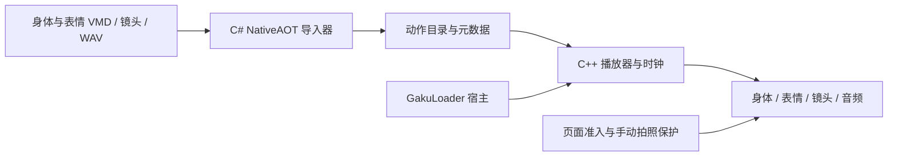

# GakuMotion 架构

GakuMotion 把动作导入和游戏内回放分成两层：C# NativeAOT 负责将 VMD 转成可直接采样的数据，C++ 插件负责播放时钟、角色绑定、姿态写入和恢复。GakuLoader 提供插件生命周期与宿主服务。

## 数据流

导入生成 `motion.gkclip`，镜头可独立存放为 `camera.gkcamera`；音频和 `info.json` 随曲目保存。格式契约见 [动作与镜头格式](formats/ACTION_FORMATS.md)。Python 工具保留为离线研究、参考与验证入口，产品导入不启动 Python。

## 模块与职责

| 位置 | 职责 |
| --- | --- |
| [`src/GakuMotionPlugin.cpp`](../src/GakuMotionPlugin.cpp) | `GakuPlugin_Query` 入口、宿主接线、IL2CPP 方法解析与运行时回调 |
| [`src/GakuMotion.hpp`](../src/GakuMotion.hpp) | Core 状态、GUI 命令队列、动作库与播放协调 |
| [`src/GkMotionPlayer.hpp`](../src/GkMotionPlayer.hpp) | 播放、暂停、预览、跳转和时钟推进 |
| [`src/GkIdolController.hpp`](../src/GkIdolController.hpp) | 角色绑定、主骨与辅助骨写入、原状态恢复 |
| [`src/GkMotionData.hpp`](../src/GkMotionData.hpp) | 二进制读取、资源预算和动作采样适配 |
| [`src/GkCsharpImport.hpp`](../src/GkCsharpImport.hpp) | NativeAOT DLL 加载、ABI 检查、工作线程与导入进度 |
| [`interop/GakuMotion.VmdImporter.Native/`](../interop/GakuMotion.VmdImporter.Native/) | 产品导入事务、身体与表情轨道、眼动、时基、镜头和曲目编辑 |
| [`candidate/csharp/`](../candidate/csharp/) | 冻结源求值器生产源码 |
| [`deps/KineTexture/`](../deps/KineTexture/) | 通用动作计算、采样、变换与重定向核心 |
| [`src/gui/`](../src/gui/) | 用户界面与操作入口 |

## 导入边界

导入器接收 UTF-8 JSON 请求，返回结构化结果。身体与独立镜头导入共用互斥门，同一时间只执行一个任务；C++ 侧在工作线程中调用，界面轮询进度日志。

新曲目与轨道编辑先在暂存区生成和校验产物，再发布到目标目录。编辑流程会检查原文件身份，避免覆盖同时发生的修改。已有曲目可编辑音频、表情与镜头；带匹配 SHA-256 绑定的 `target_leg_geometry.json` 仍不受原生目标几何烘焙支持，导入器会报告 `unsupported_target_geometry`。

身体求值、表情映射和镜头烘焙是不同步骤。当前产品层使用冻结求值器，但另有禁用腿 IK 的 FK 修正和时基处理。

## 回放与资源所有权

Core 在宿主 LateUpdate 中消费声明式配置和排队的用户操作。ImGui 提交命令，由运行时统一执行。角色回调共享状态锁，镜头选择稳定的目标角色，避免多个角色竞争同一台相机。

`.gkclip` 主姿态使用目标骨架父链上的局部旋转；录制格式使用 actor 相对世界姿态。眼动、辅助骨、根高度、角色表情适配和可选修正各有独立处理。

音频由 Windows MCI 播放，播放器读取音频状态和毫秒位置协调动作。镜头通过独立控制器接管并恢复；新配置优先请求实验性原生物理，伴生组件缺失或不可用时回退到内建物理；保存过的后端配置沿用其选择。跨插件相机共存的实现和已知范围见 [已知兼容性](USAGE.md#已知兼容性)。

## 页面与手动拍照保护

[`GkInjectionPolicy.hpp`](../src/GkInjectionPolicy.hpp)、[`GkPageObservation.hpp`](../src/GkPageObservation.hpp) 与 [`GkSceneOwnerRuntime.hpp`](../src/GkSceneOwnerRuntime.hpp) 将页面状态、活动场景和角色所有者纳入准入判断。进入不支持的页面或场景所有者变化时，需要停止注入并释放对应资源。

[`GkCaptureGuard.hpp`](../src/GkCaptureGuard.hpp) 实现当前最小手动拍照保护。GM 未接管时，手动请求直接调用原始实现，包括原有异步等待；GM 接管期间，拦截已识别的 Photography 手动 Click、按住快门入口和直接手动异步任务。松开按键仍交给原始处理。接管状态由播放（含暂停与预览）、镜头所有权或启用的舞台应用决定。

自动与公共捕获入口不安装保护 Hook；当前流程不进入旧的自动释放、恢复或异步 lease。规则与使用边界见 [使用范围](USAGE.md#打开面板)。用户操作和故障排查分别见 [使用指南](USAGE.md) 与 [故障排查](TROUBLESHOOTING.md)。

## 深入开发

- 构建命令、依赖前提和离线测试见 [构建与验证](../BUILD_NOTES.md)。
- 格式维护见 [动作与镜头格式](formats/ACTION_FORMATS.md) 与 [原生表情尾部](formats/NATIVE_FACIAL_TAIL.md)。
- Agent 工作规则见 [根指引](../AGENTS.md)；具体仓库中的历史记录保留原版本范围。
